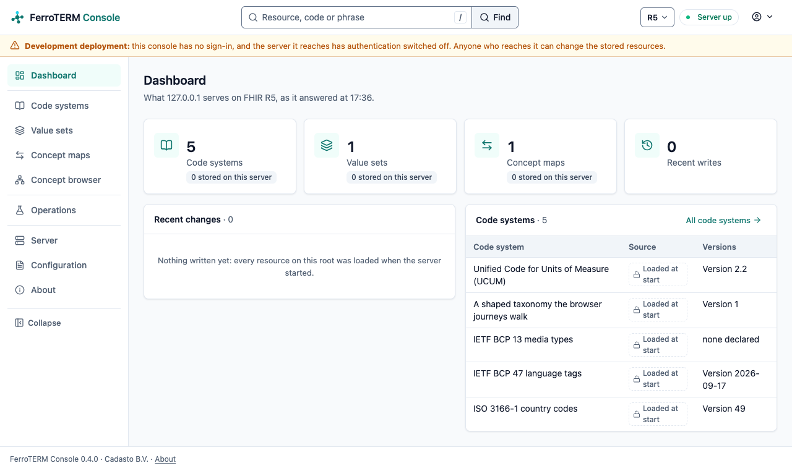

<!-- SPDX-FileCopyrightText: Cadasto B.V. -->
<!-- SPDX-License-Identifier: BUSL-1.1 -->
<div align="center">


**The FHIR terminology server for SNOMED CT, LOINC, ICD and every other code system, in one binary.**

[Documentation](https://ferroterm.eu/docs/) ·
[Quick start](#quick-start) ·
[What it implements](#what-it-implements) ·
[Licensing](https://ferroterm.eu/docs/evaluate/licensing.html)

**Project**<br>
[](https://github.com/FerroHEALTH/FerroTERM/releases/latest)
[](https://github.com/FerroHEALTH/FerroTERM/actions/workflows/ci.yml)
[](LICENSE)
[](https://ferroterm.eu/docs/)
[](https://github.com/FerroHEALTH/FerroTERM/pkgs/container/ferroterm)
[](https://github.com/FerroHEALTH/FerroTERM/pkgs/container/ferroterm)

**Quality and security**<br>
[](https://scorecard.dev/viewer/?uri=github.com/FerroHEALTH/FerroTERM)
[](https://sonarcloud.io/summary/overall?id=FerroHEALTH_FerroTERM)
[](https://sonarcloud.io/summary/new_code?id=FerroHEALTH_FerroTERM)
[](https://github.com/FerroHEALTH/FerroTERM/actions/workflows/codeql.yml)
[](https://ferroterm.eu/docs/operate/verifying-releases.html)
[](https://ferroterm.eu/docs/operate/verifying-releases.html)

**Conformance and compliance**<br>
[](https://ferroterm.eu/docs/evaluate/conformance.html)
[](https://ferroterm.eu/docs/evaluate/conformance.html)
[](https://ferroterm.eu/docs/evaluate/conformance.html)
<br>
[](https://ferroterm.eu/docs/evaluate/cra-risk-assessment.html)

</div>


## What FerroTERM is

Health records are full of codes. A diagnosis is a SNOMED CT or ICD code, a
lab result a LOINC code, a medicine a code from a national drug database.
These code systems (the shared lists of medical terms) are what let two
systems agree that they mean the same thing. Every application that records
or exchanges clinical data needs to look codes up, check them and search
them.

FerroTERM answers those questions for every application at once. It is a
FHIR terminology server in pure Rust: it loads the code systems you are
licensed for and serves them over the HL7 FHIR terminology API. Look up a
code, check that a code belongs to a list, find every narrower term,
translate a code from one system to another. It runs as one program over
an index built once per release, with no JVM, database or search engine to
operate beside it.

It is for hospitals and national eHealth programmes that need one
terminology service for all their applications, for vendors and integrators
that need SNOMED CT, LOINC or ICD in their products without a heavy
terminology stack, and for terminology teams that edit and publish value
sets in the console.



## What it implements

- [The FHIR terminology API](https://ferroterm.eu/docs/integrate/fhir-api.html): `$lookup`, `$validate-code`, `$subsumes`, `$expand`, `$translate` and `$closure`
- [FHIR R4, R4B, R5 and the R6 ballot](https://ferroterm.eu/docs/integrate/fhir-versions.html), each in its own version's shapes, in JSON and XML
- [Value sets, implicit value sets and ECL](https://ferroterm.eu/docs/integrate/ecl-value-sets.html), the SNOMED CT Expression Constraint Language
- [Stored value sets, code systems and concept maps](https://ferroterm.eu/docs/integrate/fhir-api.html#persisted-resources) with history, when you name a database
- [Syncing from a national terminology service](https://ferroterm.eu/docs/operate/sync.html), one way into a running server
- [The console](https://ferroterm.eu/docs/operate/console.html), its own image: browse, look up, expand and translate, and compose value sets

It serves these code systems, each from the release you are licensed for,
with UCUM and the registries built in:

<!-- code-systems:begin -->
SNOMED CT, LOINC, UCUM, BCP 47, BCP 13, ISO 3166-1, ICD-10 (WHO), ICD-10-NL,
ICD-10-CM, ICD-11 MMS, ICD-11 ICF, ICD-11 Foundation, ATC/DDD, ICPC-2, RxNorm,
the DHD Diagnosethesaurus and Verrichtingenthesaurus, the G-Standaard, the
Nederlandse Labcodeset, the NHG ICPC-1 to SNOMED CT map, and any FHIR
`CodeSystem`, `ValueSet`, and `ConceptMap` resources (HL7 Terminology's 900+
systems load this way).
<!-- code-systems:end -->

The [code systems page](https://ferroterm.eu/docs/evaluate/code-systems.html)
lists, per system, the versions handled, the build command and the licence
position.

## Quick start

The image serves UCUM, BCP 47, BCP 13 and ISO 3166-1 with no configuration,
so the first call needs nothing beyond Docker and `curl`. Start the server:

<!-- tour:start -->
```sh
docker run --rm -d --name ferroterm -p 8080:8080 ghcr.io/ferrohealth/ferroterm:0.4.6
```

Look up a unit of measure:

<!-- tour:lookup -->
```sh
curl --fail-with-body -s 'http://localhost:8080/r4b/CodeSystem/$lookup?system=http://unitsofmeasure.org&code=mg/dL' \
  | jq -e '.resourceType == "Parameters"'
```

Both commands are steps of
[`scripts/quickstart/tour.sh`](scripts/quickstart/tour.sh), which CI runs
against the published image; `docker stop ferroterm` stops the server. A
clinical code system such as SNOMED CT is a release you hold a licence for.
`ferroterm-build`, in the same image, turns it into an index once, and the
server reads that index at startup.
[Install and run](https://ferroterm.eu/docs/operate/install.html) and
[loading code systems](https://ferroterm.eu/docs/operate/loading-snomed.html)
continue from here.

## Deploy it

Every release publishes, from one tag:

- the server image `ghcr.io/ferrohealth/ferroterm`, the sync image
  `ghcr.io/ferrohealth/ferroterm-sync` and the console image
  `ghcr.io/ferrohealth/ferroterm-console`, for `linux/amd64` and
  `linux/arm64`;
- the `ferroterm`, `ferroterm-build` and `ferroterm-sync` binaries for
  `x86_64` and `aarch64` Linux, on glibc and on musl, and the quickstart
  `compose.yaml`, on the [GitHub release](https://github.com/FerroHEALTH/FerroTERM/releases).

[Install and run](https://ferroterm.eu/docs/operate/install.html) covers
compose and the container by hand,
[hardware sizing](https://ferroterm.eu/docs/operate/hardware-sizing.html)
the memory each code system needs, and
[health, metrics and request identifiers](https://ferroterm.eu/docs/operate/observability.html)
what an orchestrator reads.

## Security and conformance

- **What you install:** every release artifact carries signed SLSA Build
  Level 3 provenance and an SBOM you verify before you run it
  ([Verifying releases](https://ferroterm.eu/docs/operate/verifying-releases.html)).
- **Conformance:** the conformance badges above come from the HL7
  terminology ecosystem test suite, run against every change, with a
  committed pass list per FHIR version
  ([Conformance](https://ferroterm.eu/docs/evaluate/conformance.html)).
- **Measured:** every figure below comes from a benchmark record committed
  to the repository, and a check fails when a page and the records disagree.

The source is public and every feature is in this repository; there is no
paid edition with extra functions.

<details>
<summary><b>Speed and footprint</b>, measured per code system</summary>

<!-- bench-table:begin -->
| Code system | Release | Concepts | Build | Peak build memory | Index on disk | Resident | `$lookup` | `$validate-code` | `$subsumes` | `$expand` (small) | `$expand` (large) | Search | Snowstorm |
|---|---|---|---|---|---|---|---|---|---|---|---|---|---|
| [ICD-10-CM](bench/records/2026-09-23-apple-m2/icd-10-cm-2026-09-22T23-23-19-858381Z.json) | 2026 | 98,827 | 1.51 s | 359 MB | 44 MB | 91 MB | 105 µs | 60 µs | 58 µs | n/a | n/a | n/a | not run |
| [ICD-10-NL](bench/records/2026-09-23-apple-m2/icd-10-nl-2026-09-22T23-23-22-144431Z.json) | 2021 | 42,769 | 880.52 ms | 221 MB | 21 MB | 66 MB | 96 µs | 60 µs | 64 µs | n/a | n/a | n/a | not run |
| [ICD-11 MMS](bench/records/2026-09-23-apple-m2/icd-11-mms-2026-09-22T23-23-27-084934Z.json) | 2026-01 | 37,211 | n/a | n/a | 44 MB | 99 MB | 138 µs | 59 µs | n/a | 129 µs | 116 µs | 139 µs | not run |
| [LOINC](bench/records/2026-09-23-apple-m2/loinc-2026-09-22T23-23-17-47383Z.json) | 2.83 | 257,266 | 8.15 s | 2.54 GB | 310 MB | 440 MB | 136 µs | 56 µs | n/a | 126 µs | 7.23 ms | 283 µs | not run |
| [RxNorm (prescribable subset)](bench/records/2026-09-23-apple-m2/rxnorm-prescribable-subset-2026-09-22T23-23-24-615167Z.json) | 09082026 | 81,468 | 4.58 s | 667 MB | 77 MB | 133 MB | 388 µs | 114 µs | n/a | n/a | n/a | n/a | not run |
| [SNOMED CT (International edition)](bench/records/2026-09-23-apple-m2/snomed-ct-international-edition-2026-09-22T23-23-13-36281Z.json) | 20260901 | 535,502 | 14.12 s | 3.06 GB | 559 MB | 943 MB | 217 µs | 66 µs | 59 µs | 215 µs | 1.7 ms | 353 µs | not run |
| [SNOMED CT (Netherlands edition)](bench/records/2026-09-23-apple-m2/snomed-ct-netherlands-edition-2026-09-22T23-23-10-140124Z.json) | 20260630 | 548,949 | 17.66 s | 3.88 GB | 864 MB | 1.14 GB | 222 µs | 66 µs | 59 µs | 285 µs | 2.28 ms | 817 µs | not run |

Warm p50 over 200 HTTP round trips on one machine (Apple M2, 17.18 GB, macos/aarch64), FerroTERM 0.1.4 serving FHIR R4B, taken 2026-09-22. The records are under `bench/records/`; the [benchmarks page](https://ferroterm.eu/benchmarks.html) has the method, the cold and tail latencies, and how to reproduce a record.
<!-- bench-table:end -->

</details>

## Crates

The SNOMED CT, LOINC, ICD, RxNorm and Dutch release readers and the
terminology engine are published as Rust crates.

| Crate | What it does | Version | Docs | Downloads |
|---|---|---|---|---|
| [`rf2`](https://crates.io/crates/rf2) | The SNOMED CT RF2 release loader and typed component model (Apache-2.0) | [](https://crates.io/crates/rf2) | [](https://docs.rs/rf2) | [](https://crates.io/crates/rf2) |
| [`concept-graph`](https://crates.io/crates/concept-graph) | The SNOMED CT ontology as CSR adjacency and roaring transitive-closure bitmaps | [](https://crates.io/crates/concept-graph) | [](https://docs.rs/concept-graph) | [](https://crates.io/crates/concept-graph) |
| [`concept-store`](https://crates.io/crates/concept-store) | The disk-backed columnar concept and description store | [](https://crates.io/crates/concept-store) | [](https://docs.rs/concept-store) | [](https://crates.io/crates/concept-store) |
| [`designation-index`](https://crates.io/crates/designation-index) | The fst and roaring description search index | [](https://crates.io/crates/designation-index) | [](https://docs.rs/designation-index) | [](https://crates.io/crates/designation-index) |
| [`sct-ecl`](https://crates.io/crates/sct-ecl) | The SNOMED CT Expression Constraint Language lexer, parser and evaluator | [](https://crates.io/crates/sct-ecl) | [](https://docs.rs/sct-ecl) | [](https://crates.io/crates/sct-ecl) |
| [`sct-scg`](https://crates.io/crates/sct-scg) | The SNOMED CT Compositional Grammar lexer, parser and printer | [](https://crates.io/crates/sct-scg) | [](https://docs.rs/sct-scg) | [](https://crates.io/crates/sct-scg) |
| [`loinc`](https://crates.io/crates/loinc) | The LOINC release loader and typed row model | [](https://crates.io/crates/loinc) | [](https://docs.rs/loinc) | [](https://crates.io/crates/loinc) |
| [`classification`](https://crates.io/crates/classification) | The ClaML and ICD-10-CM tabular readers into one classification model | [](https://crates.io/crates/classification) | [](https://docs.rs/classification) | [](https://crates.io/crates/classification) |
| [`dhd-thesaurus`](https://crates.io/crates/dhd-thesaurus) | The DHD Diagnosethesaurus and Verrichtingenthesaurus reader | [](https://crates.io/crates/dhd-thesaurus) | [](https://docs.rs/dhd-thesaurus) | [](https://crates.io/crates/dhd-thesaurus) |
| [`gstandaard`](https://crates.io/crates/gstandaard) | The G-Standaard (Z-Index) product ladder reader | [](https://crates.io/crates/gstandaard) | [](https://docs.rs/gstandaard) | [](https://crates.io/crates/gstandaard) |
| [`labcodeset`](https://crates.io/crates/labcodeset) | The Nederlandse Labcodeset publication reader | [](https://crates.io/crates/labcodeset) | [](https://docs.rs/labcodeset) | [](https://crates.io/crates/labcodeset) |
| [`icd11`](https://crates.io/crates/icd11) | ICD-11 entities from the WHO ICD-API local deployment, cached and read | [](https://crates.io/crates/icd11) | [](https://docs.rs/icd11) | [](https://crates.io/crates/icd11) |
| [`rxnorm-rrf`](https://crates.io/crates/rxnorm-rrf) | The RxNorm Rich Release Format reader and typed row model | [](https://crates.io/crates/rxnorm-rrf) | [](https://docs.rs/rxnorm-rrf) | [](https://crates.io/crates/rxnorm-rrf) |
| [`fhir-terminology`](https://crates.io/crates/fhir-terminology) | The FHIR terminology operations over the code system provider seam | [](https://crates.io/crates/fhir-terminology) | [](https://docs.rs/fhir-terminology) | [](https://crates.io/crates/fhir-terminology) |

## Part of FerroHEALTH

FerroTERM is one of five [FerroHEALTH](https://ferrohealth.eu) servers.
Each does one job and reaches the others only over published standards:
FerroEHR stores the record, FerroBRIDGE translates it to FHIR and the OMOP
research model, FerroFED connects records across organisations and borders,
FerroPIX matches patient identities, and FerroTERM serves the code systems.
Any FHIR client can use FerroTERM.

## Documentation

- [The FerroTERM book](https://ferroterm.eu/docs/): evaluate, integrate,
  operate and contribute, and the
  [FerroHEALTH book](https://ferrohealth.eu/docs/) for what the family
  shares
- [What FerroTERM is](https://ferroterm.eu/docs/evaluate/what-ferroterm-is.html),
  [architecture at a glance](https://ferroterm.eu/docs/evaluate/architecture.html)
  and [how it compares](https://ferroterm.eu/docs/evaluate/comparison.html)
- [Benchmarks](https://ferroterm.eu/docs/evaluate/benchmarks.html), the
  [changelog](CHANGELOG.md) and the
  [GitHub releases](https://github.com/FerroHEALTH/FerroTERM/releases)

## Support and contributing

- [Support](SUPPORT.md) and the [security policy](SECURITY.md)
- [Contributing](CONTRIBUTING.md), [code of conduct](CODE_OF_CONDUCT.md),
  [governance](GOVERNANCE.md), [maintainers](MAINTAINERS.md) and the
  [AI statement](AI_STATEMENT.md)

## Licence

Business Source License 1.1 ([LICENSE](LICENSE)): free outside production
and for non-commercial production use, a commercial licence from Cadasto
B.V. for other production use, and Apache License 2.0 four years after each
version; the `rf2` crate is Apache-2.0 today. The code systems keep their
own licences, and the
[licensing page](https://ferroterm.eu/docs/evaluate/licensing.html) says
which applies to you.
