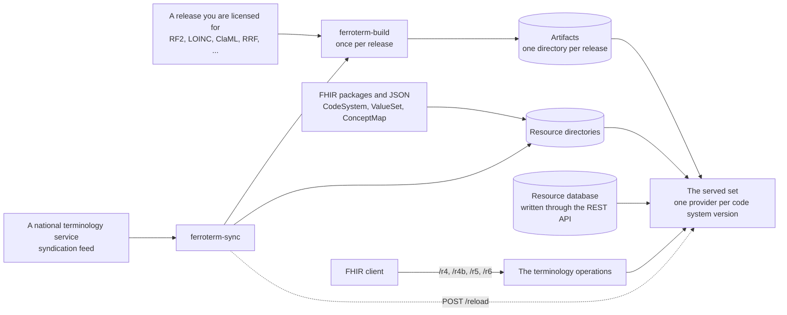
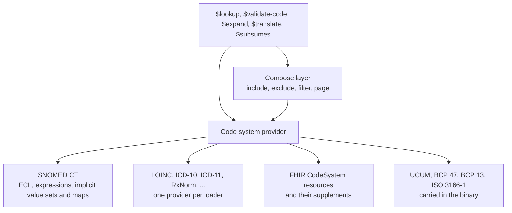
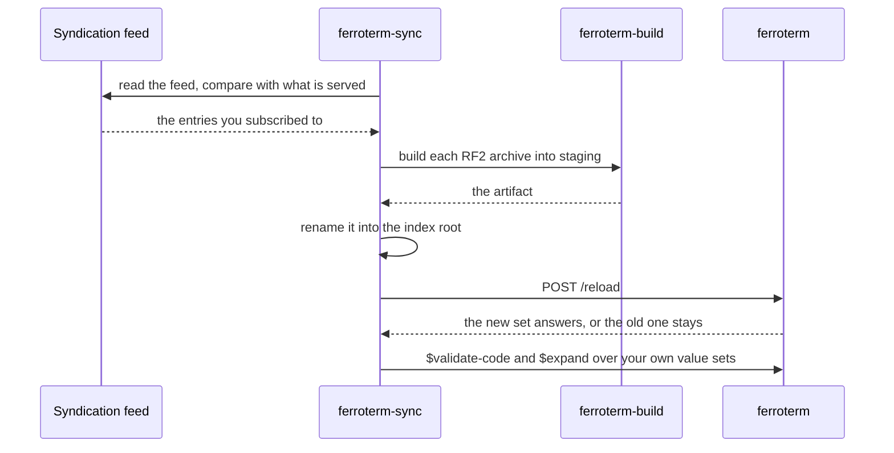

<!-- SPDX-FileCopyrightText: Cadasto B.V. -->
<!-- SPDX-License-Identifier: BUSL-1.1 -->

# How FerroTERM serves terminology

**Audience:** integrators and operators who want the model behind the how-to
pages; decision makers who want to know which parts a specification governs
and which are FerroTERM's own design.

FerroTERM is a FHIR terminology server: a client asks it about codes, and it
answers from the code systems, value sets and concept maps a deployment
loaded. The FHIR specification defines what a client may ask and what the
answer looks like; FerroTERM decides how the content is stored, loaded and
kept current. This page explains the parts and how they relate, and names the
specification that governs each part, or says that none does.

<!-- toc -->

## The parts at a glance

Solid arrows carry terminology content. The dotted arrow is the one control
call: the sync service asks the server to read its directories again.

## The operations a client calls

The FHIR terminology service defines what a terminology server answers
(FHIR R4, [Terminology Service](https://hl7.org/fhir/R4/terminology-service.html);
FHIR R5, [Terminology Service](https://hl7.org/fhir/R5/terminology-service.html)).
FerroTERM answers five operations, each defined by an `OperationDefinition`
of the FHIR version in play:

| Operation | The question it answers | Definition (R4) |
|---|---|---|
| `CodeSystem/$lookup` | What does this code mean: its display, designations and properties? | [codesystem-operation-lookup](https://hl7.org/fhir/R4/codesystem-operation-lookup.html) |
| `CodeSystem/$validate-code`, `ValueSet/$validate-code` | Is this code valid, is its display right, and is it in this value set? | [codesystem-operation-validate-code](https://hl7.org/fhir/R4/codesystem-operation-validate-code.html), [valueset-operation-validate-code](https://hl7.org/fhir/R4/valueset-operation-validate-code.html) |
| `ValueSet/$expand` | Which codes does this value set contain? | [valueset-operation-expand](https://hl7.org/fhir/R4/valueset-operation-expand.html) |
| `ConceptMap/$translate` | Which codes of another system does this code map to? | [conceptmap-operation-translate](https://hl7.org/fhir/R4/conceptmap-operation-translate.html) |
| `CodeSystem/$subsumes` | Does one code subsume the other? | [codesystem-operation-subsumes](https://hl7.org/fhir/R4/codesystem-operation-subsumes.html) |

Each FHIR version has its own base: `/r4`, `/r4b`, `/r5`, and `/r6` for the
R6 ballot. A version's base accepts the parameters that version's
`OperationDefinition` declares, plus the ones the HL7 terminology ecosystem
requires of every server
([tx ecosystem IG, Requirements](https://hl7.org/fhir/uv/tx-ecosystem/requirements.html)),
and refuses any other with an `OperationOutcome`. A parameter R5 adds is
answered on `/r5` and refused on `/r4`. The model behind each base is the
generated [`fhir-types`](https://crates.io/crates/fhir-types) crate, one
module per version, so a version's surface follows its own package
([FHIR versions](../integrate/fhir-versions.md)).

FHIR R5 states how one server serves several versions: a server may give
each version its own base, where "the same record has a different identity
depending on the version of FHIR in use"
([FHIR R5, Versioning](https://hl7.org/fhir/R5/versioning.html)). FerroTERM
takes that strategy. One engine answers every base, and each base maps the
engine's answer into its own version's shapes.

A failure is an `OperationOutcome` whose issue carries a code from the FHIR
`issue-type` value set and, for a terminology failure, a coding from
`http://hl7.org/fhir/tools/CodeSystem/tx-issue-type`, the issue types the tx
ecosystem uses ([tx ecosystem IG, Requirements](https://hl7.org/fhir/uv/tx-ecosystem/requirements.html)).
A code system the server does not hold is an answer of its own: a
`$validate-code` against it is `result = false` with
`x-caused-by-unknown-system`, so a validator can say which content is
missing. [The FHIR terminology API](../integrate/fhir-api.md) has every
operation's parameters and answers.

## One engine, one provider per code system

The operations know nothing about any particular code system. They call a
provider: a code system version answers a lookup, a status, a designation by
language, its properties, its filters, its hierarchy when it has one,
subsumption, and the implicit value sets it defines. The compose layer of a
value set (includes, excludes, filters, paging, `total`) sits once above
every provider.

A provider declares what it answers in `TerminologyCapabilities`
(`GET [base]/metadata?mode=terminology`): its filters, its properties, and
the implicit value sets it resolves. The declarations differ by system, so a
client reads them for the system it uses. Code system semantics live in the
provider: the SNOMED CT URI forms and the Expression Constraint Language in
the SNOMED CT provider ([FHIR R4, Using SNOMED CT with
FHIR](https://hl7.org/fhir/R4/snomedct.html)), the LOINC answer lists in the
LOINC provider. The provider seam is FerroTERM's own design: no
specification governs how a server divides its code.

## How content is loaded

A deployment serves content from four sources, which differ in who writes
them and how long they live.

| Source | Written by | Lives | Configured as |
|---|---|---|---|
| Artifacts | `ferroterm-build`, from a release | until you remove the directory | `terminology.index` |
| Resource directories | you, or the sync service: FHIR packages and JSON files | until you remove the file | `terminology.code_systems` |
| The resource database | clients, through the REST API | across restarts | `terminology.resources` |
| Request-scoped resources | the client, in `tx-resource` parameters | one request, or one `$cache-control` cache | nothing |

A large code system arrives as a release in its publisher's own format: an
RF2 archive for SNOMED CT, a zip for LOINC, a ClaML document for ICD-10.
`ferroterm-build` reads it once and writes an artifact: a directory with a
`redb` store, dense columns, the hierarchy as compressed sparse rows with its
transitive closure in roaring bitmaps, a word index for text search, and a
`manifest.json` that names the system and the version. The server reads the
artifact at startup and never parses a release. A subsumption test is then a
bitmap membership test, and an `$expand` of a subtree a bitmap returned
directly. The artifact layout and the offline build are FerroTERM's own
design: no specification governs how a server stores a code system.

A code system that FHIR resources describe completely arrives as those
resources. The server reads every `CodeSystem`, `ValueSet`, `ConceptMap`,
`NamingSystem` and `Provenance` in a resource directory, in the FHIR version
its `package.json` declares, and serves it at its own `url` and `version`. A
`CodeSystem` with `content = supplement` adds to the system it supplements
([FHIR R4, CodeSystem
supplements](https://hl7.org/fhir/R4/codesystem.html#supplements)). A system
served from an artifact answers a read of its `CodeSystem` with its
definition and `content = not-present`: the codes come from the operations,
never from the resource
([FHIR R4, CodeSystemContentMode](https://hl7.org/fhir/R4/codesystem-content-mode.html)).

A value set reaches `$expand` in five ways: loaded from a directory,
persisted in the database, inline in the request, request-scoped in a
`tx-resource`, or implied by a URL a code system defines, such as
`http://loinc.org/vs` or the SNOMED CT `?fhir_vs` forms. A request-scoped
resource with the same `url` and `version` as a loaded one shadows it for
that request. Without a `version`, a canonical resolves to the greatest
version the server holds, and every answer names the version it used.

The served set is one immutable registry. A reload, on `SIGHUP` or
`POST /reload` on the admin listener, opens every artifact and directory
again, builds a new registry and swaps it in one step; a request in flight
finishes on the set it started on. An artifact that does not open stops the
start, and refuses a reload while the old set keeps answering, because an
answer of "not found" for a code system that failed to load reads the same
as "this code does not exist". That rule is FerroTERM's own design, and
[Configuration](../operate/configuration.md#a-refused-artifact-stops-the-start)
gives it in full.

## How content stays current

A new release becomes a new artifact beside the old one. An index root is a
directory whose children are artifacts, one per release; the server lists
it on every reload, and both releases are served until you remove the older
one. Because a canonical without a version resolves to the greatest version,
publishing the new release is what promotes it.

`ferroterm-sync` automates that cycle from a national terminology service's
Atom feed: it takes the releases you subscribed to, builds them, renames them
into the index root, asks the server to reload, and prunes the releases
retention no longer keeps. It then revalidates your own value sets and
concept maps through the public FHIR API and reports what the release
changed for them, and changes nothing. The sync service runs beside the
server and never inside it, so the server has no outbound connection of its
own beyond the issuer it checks tokens with and the opt-out usage report.
The feed is an Atom feed ([RFC 4287](https://www.rfc-editor.org/rfc/rfc4287))
with the NCTS Atom Syndication Format extensions; the schedule, the activation and the
retention are FerroTERM's own design
([Syncing from a national terminology service](../operate/sync.md)).

## Conformance: the tx ecosystem test suite

The HL7 terminology ecosystem implementation guide publishes the test cases
the FHIR Validator runs against a terminology server
([tx ecosystem IG](https://hl7.org/fhir/uv/tx-ecosystem/)). CI runs the
suite's general mode against a release build on every pull request, once for
`/r4`, `/r4b` and `/r5`, and compares the result with a committed pass list
per version. A listed case that fails is a regression and fails the change; a
case that starts passing joins the list in the change that makes it pass. The
modes that need licensed content (SNOMED CT, LOINC, ICD-11) run by hand.

The specification is the oracle, and the suite is evidence of it. Where a
case expects a parameter or an extension that no published
`OperationDefinition` or package defines, FerroTERM answers what the
published definitions say and records the difference as an upstream report.
Reference servers such as tx.fhir.org settle only what the specifications
leave silent. Passing the suite is not a certification: HL7 issues none for
terminology servers. [Conformance](../evaluate/conformance.md) has the
counts and every case that does not pass, with its reason.

## Licensing: software and content apart

Two licences meet in a deployment, and they never mix.

- **The software** is under the Business Source License 1.1: free for every
  non-production use and for non-commercial production use, a commercial
  licence for other production use, and Apache License 2.0 four years after
  each version ([Licensing](../evaluate/licensing.md)).
- **The content** is licensed by its publisher: SNOMED CT by SNOMED
  International, LOINC by Regenstrief, ICD by the WHO, RxNorm by the NLM.
  FerroTERM ships none of it, in the repository or in any build. You load the
  release you are licensed for, and the build turns it into an artifact on
  your own machine.

The registry systems the binary carries (UCUM, BCP 47, BCP 13 and ISO
3166-1) are open registries, each kept under its own licence beside the data.
The tests use shaped, synthetic content only, so the repository holds no
licensed content either. [Code systems served](../evaluate/code-systems.md)
lists each system with its licence position.
