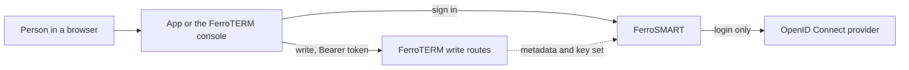
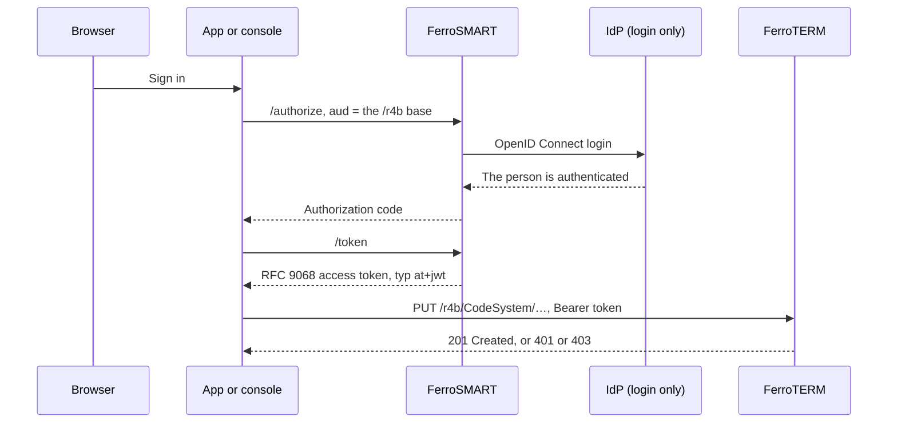

<!-- SPDX-FileCopyrightText: Cadasto B.V. -->
<!-- SPDX-License-Identifier: BUSL-1.1 -->

# Running behind FerroSMART

FerroSMART is the FerroHEALTH SMART App Launch 2.x authorization server. It
logs a person in at any OpenID Connect provider upstream, for login only, and
issues RFC 9068 access tokens for the FerroHEALTH products. FerroTERM then
runs as a resource server: an app, the console or a backend service takes its
token from FerroSMART and calls FerroTERM's write routes with it, and
FerroTERM never sees the provider's tokens. FerroSMART's architecture
describes the whole deployment in
[§13.21 A product behind FerroSMART](https://github.com/FerroHEALTH/FerroSMART/blob/main/docs/architecture.md#1321-a-product-behind-ferrosmart);
this page is FerroTERM's side of it.





Reading needs no token: the read surface stays open whatever `[auth]` says,
so only writes and the admin listener go through FerroSMART.

## FerroSMART's resource table

FerroSMART issues a token only for a resource it names. FerroTERM serves one
FHIR base per version, so list each base your apps write through:

```toml
[[ferrosmart.resource]]
base = "https://tx.example.org/r4"
kind = "fhir"

[[ferrosmart.resource]]
base = "https://tx.example.org/r4b"
kind = "fhir"
```

Each base sits under FerroTERM's [`fhir.base_url`](configuration.md), and a
token whose `aud` names any served version's base writes on every version.

## FerroTERM's issuer table

FerroTERM trusts FerroSMART with one named issuer table that names only the
issuer:

```toml
[fhir]
base_url = "https://tx.example.org"

[auth.issuer.ferrosmart]
issuer = "https://smart.example.org"
```

The issuer is a SMART App Launch 2.2 authorization server, and with no
`audience` key its audience is the served version bases, so neither needs a
key. FerroSMART's client registry is the one list of clients: a token
FerroSMART signs whose `aud` names a FerroTERM base admits its client, and
FerroTERM keeps no client list of its own. A token's `typ` is `at+jwt` or
`application/at+jwt` (RFC 9068 §4), and `scope` is a required claim. The
caller is read from the token's standard claims:

| Token | Read as |
|---|---|
| A user's token (`sub` names the user, `client_id` the app) | a user, by the resource type of its `fhirUser` claim, or a user of no stated type without one; a `user/` scope decides what they write |
| A token with an RFC 8693 `act` | the user, with the actor that acts for them |
| A SMART Backend Services token (`sub` equals `client_id`, RFC 9068 §2.2), such as the synchronisation service's | a backend service, with the `system/` scopes it carries |
| A patient's or a `RelatedPerson`'s token under `patient/` scopes | admitted, and refused every write with `403`: a terminology resource sits in no patient's compartment |
| A token whose `aud` names another server, with no `scope`, or with another `typ` | refused: `401` |

Use one table for FerroSMART: two issuer tables naming one issuer refuse the
start. Every other key of the issuer table and every profile key is on the
[Configuration](configuration.md#authentication) page.

The admin listener serves no FHIR base, so it takes only the audiences an
issuer table names outright: with no `audience` key, FerroSMART's tokens open
the write routes alone, and the admin listener admits the Basic users of
`[[auth.basic.users]]`.

## The discovery document

An app that starts at FerroTERM reads
`GET /r4b/.well-known/smart-configuration` and must find FerroSMART there.
With FerroSMART as FerroTERM's one SMART issuer, the
[described-issuer rule](configuration.md#the-described-issuer) picks it, and
the document names FerroSMART's `authorization_endpoint` and
`token_endpoint`. With other issuers beside it, set
`[auth] described_issuer = "ferrosmart"`, the name of its table.

No specification governs this deployment shape: it is FerroHEALTH's own
design, built from SMART App Launch 2.2.0, RFC 9068 and OpenID Connect.
