<!-- SPDX-FileCopyrightText: Cadasto B.V. -->
<!-- SPDX-License-Identifier: BUSL-1.1 -->

# The console

The FerroTERM Console is the browser interface of a FerroTERM deployment: a
dashboard of what the server serves, listings and detail screens for its code
systems, value sets and concept maps, a runner for each terminology operation,
and editors for the resources your deployment writes. It is its own program
and its own image, `ferroterm-console`, which you run beside the server. It is
one of the FerroHEALTH consoles and looks like the others: the same shell,
navigation, tables and forms, in FerroTERM's teal.

The console renders every page on its own server and talks to FerroTERM over
the public FHIR API, server to server. Anything the console does, any other
FHIR client can do. The terminology server serves no user interface itself.

## Running it

With the quickstart, the `console` profile starts the console beside the
server:

```console
$ docker compose --profile console up
$ open http://localhost:3000
```

Run the binary yourself with a configuration file:

```console
$ ferroterm-console serve --config console.toml
$ ferroterm-console config check --config console.toml
$ ferroterm-console healthcheck
```

The configuration is a TOML file, named by `--config` or
`FERROTERM_CONSOLE_CONFIG`. Every key can be set from the environment as
`FERROTERM_CONSOLE__<SECTION>__<KEY>`, for example
`FERROTERM_CONSOLE__FERROTERM__BASE_URL`, and every secret also reads from a
file through its `_file` sibling. An unknown key is refused at start.

```toml
[server]
listen = "0.0.0.0:3000"
site_root = "/site"

[ferroterm]
# Where the console reaches the server, on your private network.
base_url = "http://ferroterm:8080/"
# The address readers see the FHIR API at, shown on the screens.
public_url = "https://terminology.example.org/"
# The synchronisation service's admin listener, shown on Configuration.
sync_url = "http://ferroterm-sync:8090/"
timeout_ms = 30000

[session]
secure_cookie = true
idle_timeout_s = 1800
absolute_timeout_s = 28800
max_sessions = 1000

[oidc]
issuer = "https://idp.example.org/realms/ferroterm"
authorization_endpoint = "https://idp.example.org/realms/ferroterm/protocol/openid-connect/auth"
token_endpoint = "https://idp.example.org/realms/ferroterm/protocol/openid-connect/token"
jwks_uri = "https://idp.example.org/realms/ferroterm/protocol/openid-connect/certs"
client_id = "ferroterm-console"
client_secret_file = "/run/secrets/console-client-secret"
redirect_uri = "https://console.example.org/auth/callback"
scopes = ["openid", "fhirUser", "user/CodeSystem.cud", "user/ValueSet.cud", "user/ConceptMap.cud"]
end_session_endpoint = "https://idp.example.org/realms/ferroterm/protocol/openid-connect/logout"
revocation_endpoint = "https://idp.example.org/realms/ferroterm/protocol/openid-connect/revoke"
post_logout_redirect_uri = "https://console.example.org/"
```

## Signing in

Reading is open: a visitor reads every screen, because the server's read
surface asks for no token. Signing in is for editing. Without an `[oidc]`
section the console offers no sign-in and no editing screen.

With one, the top bar gains **Sign in**. The console signs you in at your
identity provider with the authorization code flow and PKCE and keeps the
session on its own server, behind one cookie the browser cannot read; the
browser never holds a token. Register the console as a client at the provider
with the redirect address `https://your-console/auth/callback` and the scopes
above, and point the terminology server at the same issuer with
`FERROTERM_AUTH__ISSUER` and the audience the provider puts in the console's
tokens with `FERROTERM_AUTH__AUDIENCE`
([Configuration](configuration.md#authentication)), so it accepts the tokens
the console presents. A provider that types its access tokens `JWT` rather
than `at+jwt` (RFC 9068) needs `FERROTERM_AUTH__TOKEN_PROFILE=jwt`. A role that
gets none of the three `user/` scopes reads the server and changes nothing;
the menu under your name says what you may edit.

**Sign out** ends the session, revokes its token where the provider publishes
a revocation endpoint (RFC 7009), and takes you to the provider's end-session
endpoint when one is configured.

## The screens

Every screen is drawn whole on the console's server and works with scripting
off; the browser adds the theme menu, the copy buttons, the concept tree and
the keyboard shortcuts on top. The top bar carries the command bar, the FHIR
version you are reading through, the server's health, and the menu under your
name with the theme. The version menu keeps the version for your session, so
every screen you open next reads the same root. An address that names a
version with `?fhir=` reads that version for that page.

### Dashboard

What the server serves on the version in view: the number of code systems,
value sets and concept maps, the writes it recorded most recently, the first
code systems, and the way into each operation.

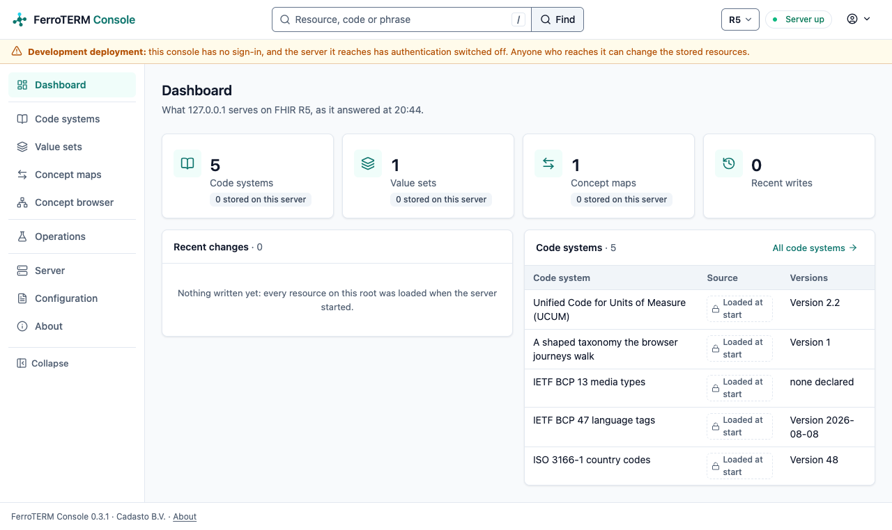

### Code systems

Every code system the root declares in its `TerminologyCapabilities`, with its
source, the versions it holds, its content mode and whether it reads as a
hierarchy. Sort by a column and page through; past ten rows, find by name or
canonical and keep the sources you tick in the **Source** menu. Each row opens the code
system's own screen, whose tabs are links: **Overview** (its definition from
the published resource), **Versions** (what this server declares it can do
with each version), **History** for a resource this server stores, and
**JSON**, the resource as the server sent it.

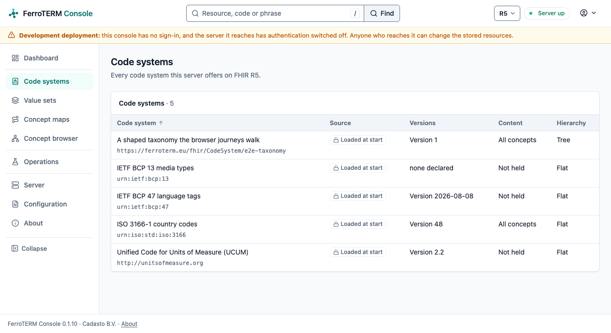

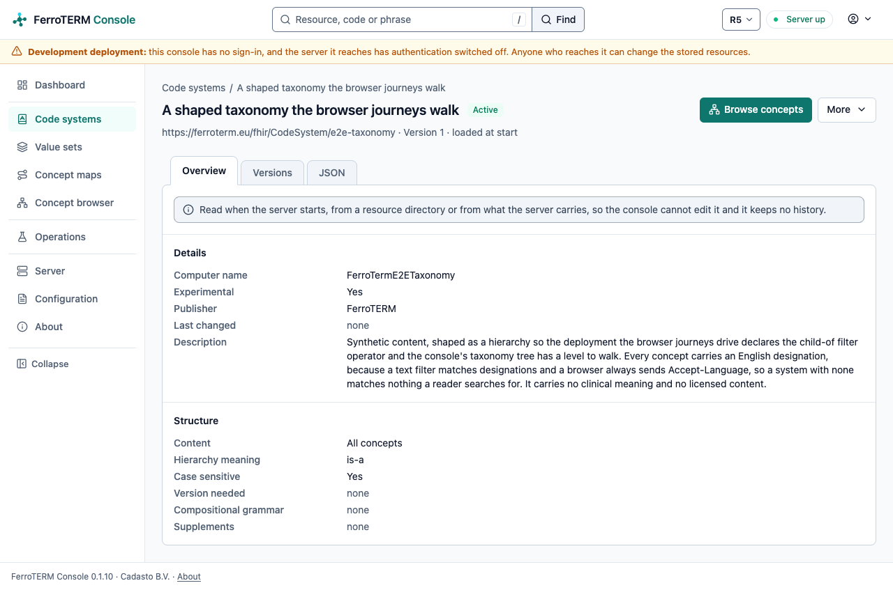

### Concept browser

Search a code system, read a concept with `$lookup`, and walk its hierarchy one
level at a time, where its version declares the `child-of` filter operator.
Every move is in the address, so a walk is a link you can send.

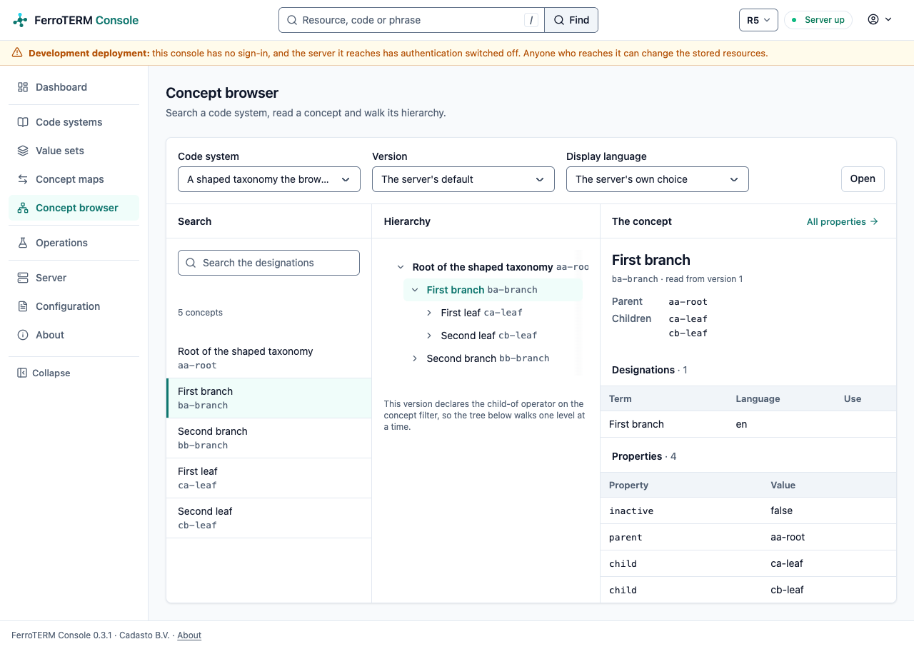

### Value sets and concept maps

The resources the root publishes. A value set opens on **Definition** (what
its definition selects), **Expansion** (the codes it expands to, a page at a
time) and **JSON**; a concept map on **Mappings** (every mapping it writes,
group by group), **Overview** and **JSON**.

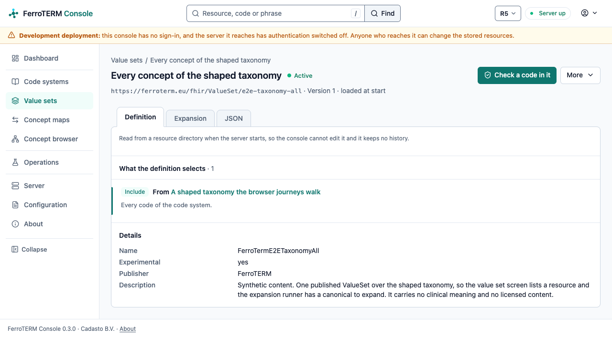

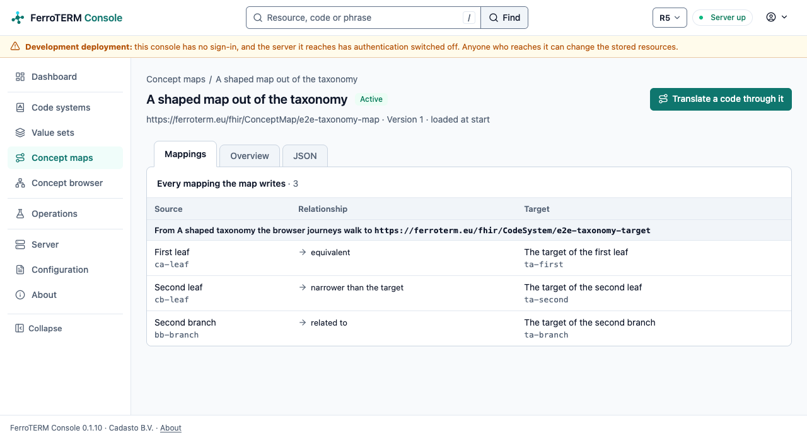

### The operations

Look up a code (`$lookup`), check a code against a code system or a value set
(`$validate-code`) and how two codes relate (`$subsumes`), expand a value set
(`$expand`) a page at a time, and translate a code through the concept maps
(`$translate`). Each runner offers the canonicals this root publishes, keeps
its parameters in the address, and draws the answer as a result panel, with a
refusal shown in the server's own words.

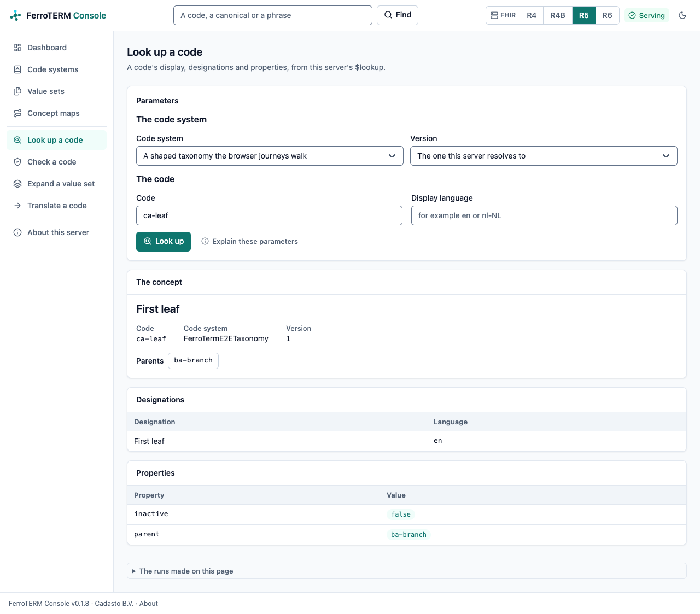

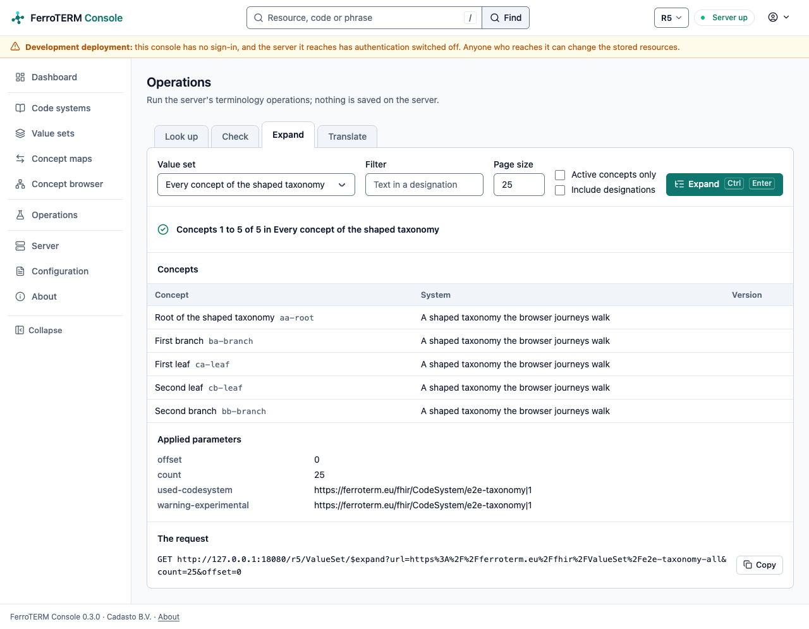

### Server, Configuration and About

**Server** shows the four FHIR roots side by side, read from each root's
`CapabilityStatement`, the operations each root declares, and the
conformance and benchmark evidence this build ships. **Configuration** lists
the settings the console runs with, secrets redacted, and **How configuration
works**, at the end of the line that names the file, opens a dialog on where
they come from and how you change them. When the console was started with a
configuration file, **More** in the title row offers **Copy the file's path**,
the path shown under it. **About** names the
build, the licence and the projects it stands on.

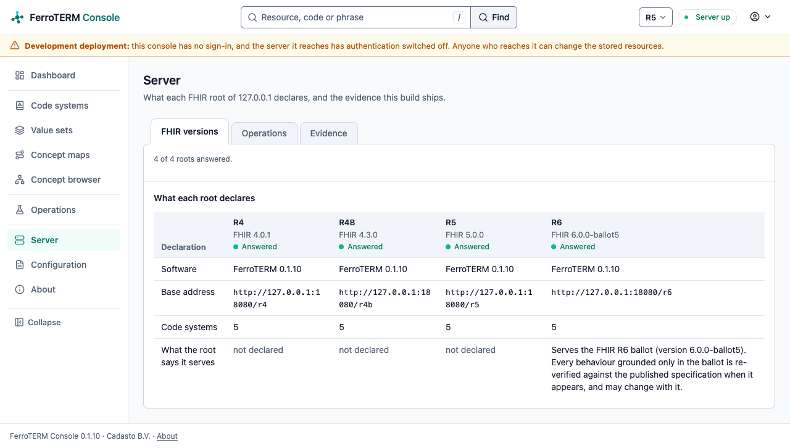

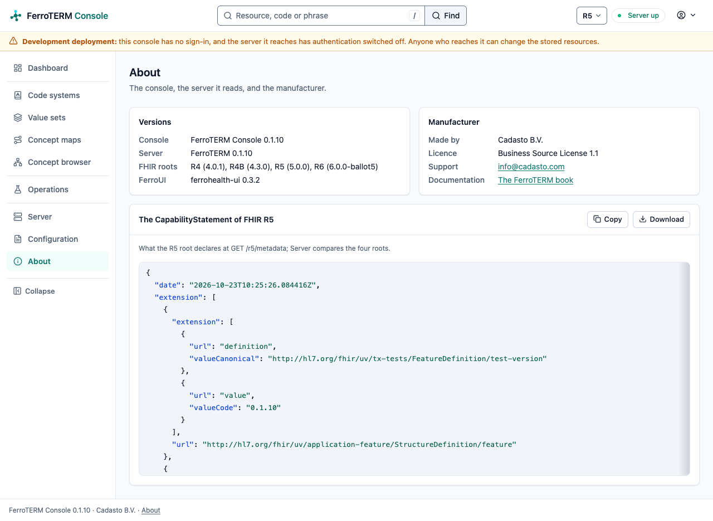

### Your preferences

Open from the menu under your name: the theme and the density, reduced
motion, the default FHIR version, the display language concept names are
asked for in, the page size (25 rows unless you choose another) and the
keyboard hints. The console keeps each in a cookie of its own for your
browser and draws the next page in it.

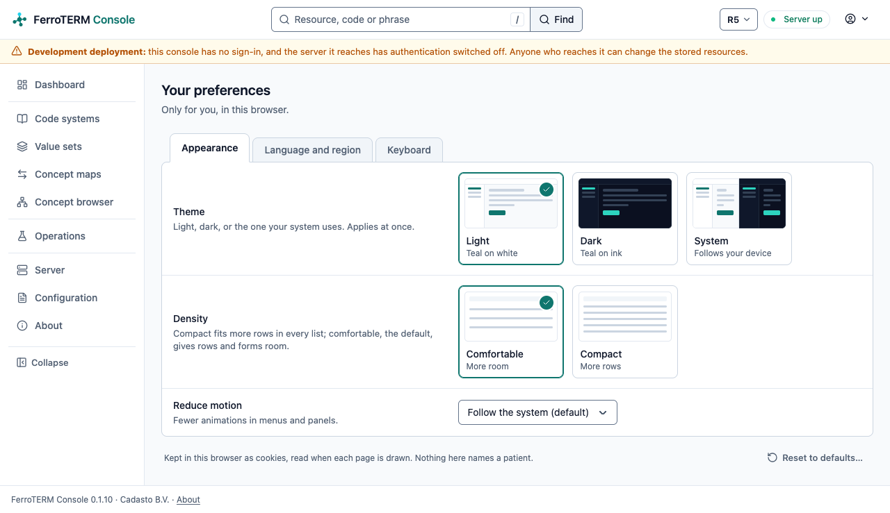

### Editing

Signed in with the write scopes, the **Code system editor**, the **Value set
composer** and the **Concept map editor** write local resources through the
same REST API any client uses. Each is a plain form: **Save** posts it, the
console sends the resource, and the page says which version the server wrote.
`Ctrl S` presses Save. Every save states `If-Match`, so a resource someone
changed since you opened it is refused with `412`, your draft stays in the
form, and the screen offers to reload the current version. Content your
server serves from its loaded indexes has no write path, so it opens to read
and offers no save.

## Composing a value set

Signed in with `user/ValueSet.cud`, the **Value set composer**
screen builds a local `ValueSet.compose` and saves it through the same REST API
any client uses.

A definition is a set of clauses. Every include adds to the selection and the
value set is the union of them all; the criteria inside one include are taken
together, so a code has to satisfy all of them; an exclude takes codes back out
of that union (<https://hl7.org/fhir/R4B/valueset.html#compositions>). The
screen says which of those each clause is doing, in a sentence under it, and
names the invariant a clause breaks by its own number: `vsd-1` for a clause
that selects nothing, `vsd-2` for codes or filters with no code system, `vsd-3`
for codes and filters at once.

A clause draws in a value set your server already publishes, picked from the
list, or any canonical you type, including a form a code system defines for
itself. It selects out of a code system with the filter properties and
operators that system's served version declares, which the screen reads from
`TerminologyCapabilities`: a system declaring an expression-constraint filter
offers it here, a system declaring none offers none, and a clause pinned to a
code system version is offered that version's filters. A filter value the
server refuses is shown with the character its diagnostic points at marked.

Own codes are typed one per row, and each one can carry the display this value
set gives it; the preview shows any code the code system does not hold.

**Run the preview** expands the definition on screen, saved or not: it posts it
to `ValueSet/$expand` in the `valueSet` parameter and pages the answer
(<https://hl7.org/fhir/R4B/valueset-operation-expand.html>). The page and the
text filter are in the address, so a preview is a link you can send.

**Save** sends the resource with `If-Match`, so a value set someone else
changed since you opened it is refused with 412 and the screen offers to reload
it (<https://hl7.org/fhir/R4B/http.html#concurrency>). An update replaces the
whole resource, so the save carries back every element the form does not draw,
from the description to a code's own designations
(<https://hl7.org/fhir/R4B/http.html#update>). Every refusal is shown in the
server's own words. Content your server serves from its loaded indexes has no
write path, so it opens here to read and offers no save under any role.

## History and restoring a version

A resource this server stores has a **History** tab, which opens `/history` on
it. The screen lists the revisions the server holds, newest first, with when
each was written and the interaction that wrote it where the answer states
one.

How the list is read depends on what your server declares in its
`CapabilityStatement`. A server declaring `history-instance` answers the whole
list at once. FerroTERM declares `vread`, so the console reads each earlier
revision back one request at a time, counting down from the revision the
resource states, and the screen says so. Only the 20 most recent revisions are
listed.

**Compare** takes an earlier and a later revision and lists the elements they
disagree about: the path, whether it was added, removed or changed, and both
values. It compares the two documents structurally, so what you read is which
elements moved. `meta.versionId` and `meta.lastUpdated` are left out, because
your server assigns both on every write. The two revisions are in the address,
so a comparison is a link you can send.

**Restore** on an earlier revision asks first, in a dialog that names the
revision, and then writes that revision's whole resource back as a new one.
It states `If-Match` of the revision the server holds now, so a change someone
else made since you opened the screen is refused with 412 and the screen
offers to reload the revisions. The page then says which revision the restore
wrote. Restore appears only for an account whose token carries the write scope
for the resource type; everyone else reads the same revisions and restores
nothing.

What a release of the [synchronisation service](sync.md) changed about the
resource is planned work for this screen; the console no longer reads the
service's admin listener.

## About these screenshots

Each image is a capture of a running console over a running server, taken by
a browser driven through WebDriver, over the synthetic fixture in
`e2e/fixtures/codesystems`. The repository distributes no SNOMED CT content and
no derived edition data, so no licensed release is ever the subject of one.

The browser battery's script refreshes them when asked, and then runs only the
capture:

```console
$ scripts/ui-e2e.sh --docs-shots
```

`--review DIR` captures every screen at desktop and phone width in both
themes, with the hover, focus and open states, into `DIR` for a visual review
of a change. With `--pseudo-locale` as well, the review draws every screen in
`en-XA`, a pseudo-locale written from the English catalog with every message
40 percent longer, accented and bracketed, so the capture shows where a
screen has no room for a longer translation. The console's words come from
one catalog per language, so a language joins as one catalog file. Without
either flag the battery changes no file in the checkout, which is why an
ordinary run on a pull request never rewrites an image here.
