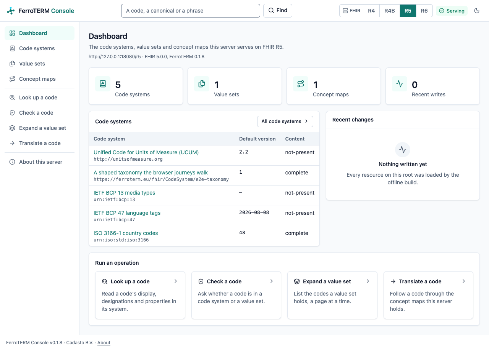
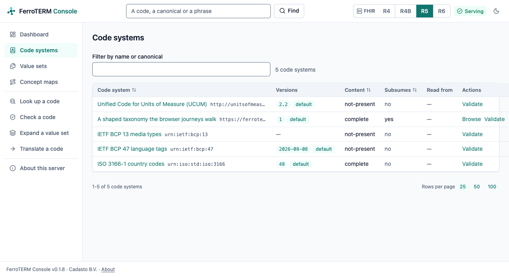
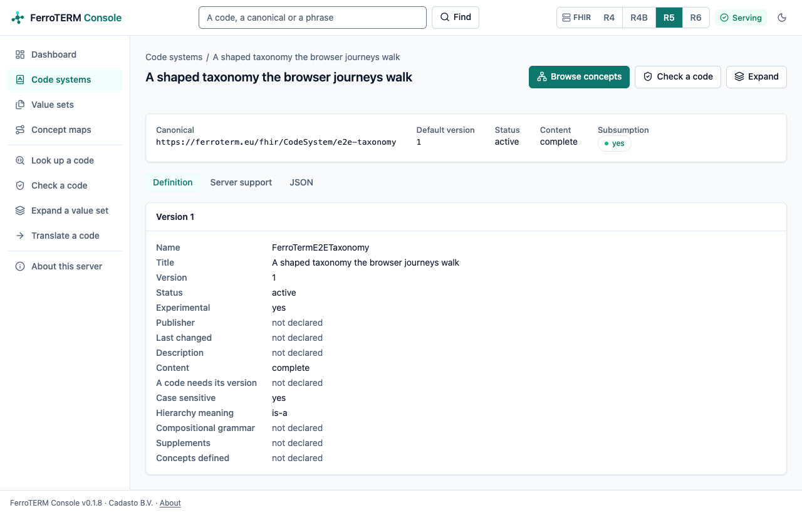
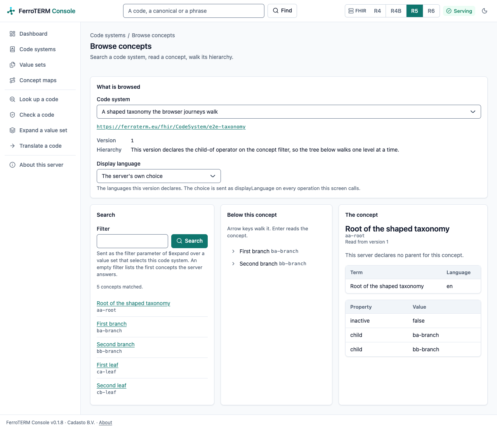
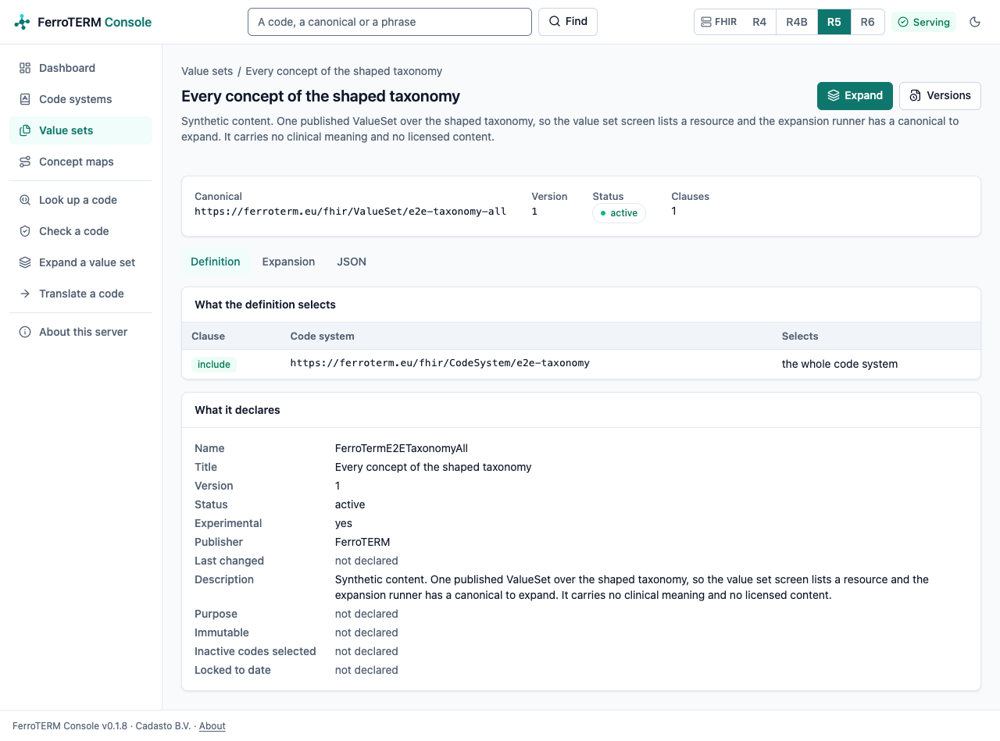
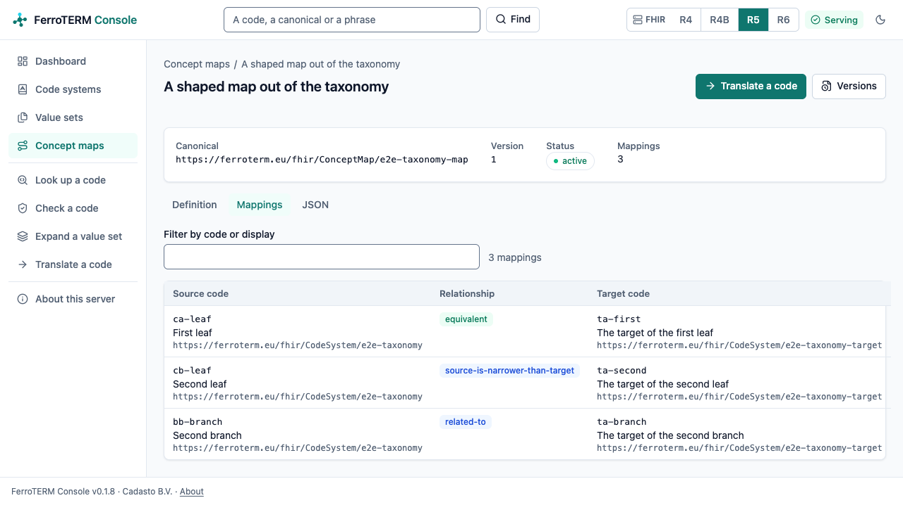
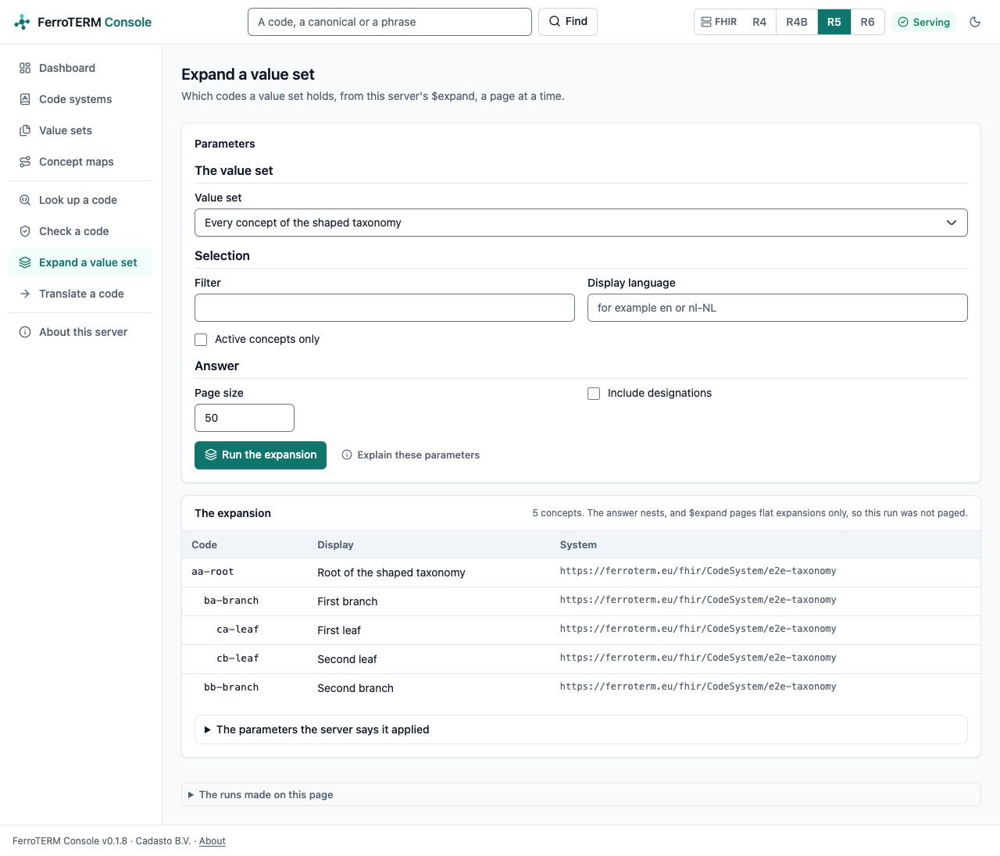
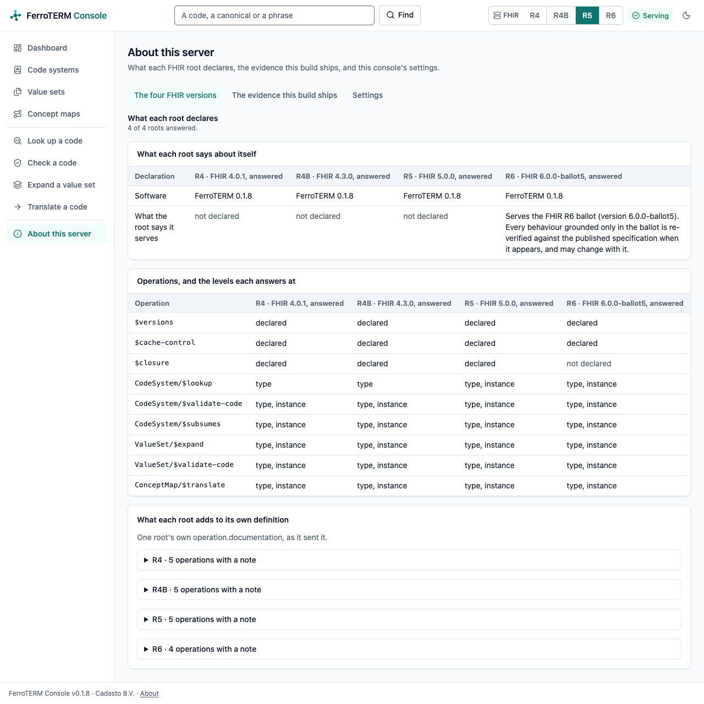

# The console

The FerroTERM Console is the browser interface of a FerroTERM deployment: a
dashboard of what the server serves, listings and detail screens for its code
systems, value sets and concept maps, a runner for each terminology operation,
and editors for the resources your deployment writes. It is its own program
and its own image, `ferroterm-viewer`, which you run beside the server. It is
one of the FerroHEALTH consoles and looks like the others: the same shell,
navigation, tables and forms, in FerroTERM's teal.

The console renders every page on its own server and talks to FerroTERM over
the public FHIR API, server to server. Anything the console does, any other
FHIR client can do. The terminology server serves no user interface itself.

## Running it

With the quickstart, the `viewer` profile starts the console beside the
server:

```console
$ docker compose --profile viewer up
$ open http://localhost:3000
```

Run the binary yourself with a configuration file:

```console
$ ferroterm-viewer serve --config console.toml
$ ferroterm-viewer config check --config console.toml
$ ferroterm-viewer healthcheck
```

The configuration is a TOML file, named by `--config` or
`FERROTERM_VIEWER_CONFIG`. Every key can be set from the environment as
`FERROTERM_VIEWER__<SECTION>__<KEY>`, for example
`FERROTERM_VIEWER__FERROTERM__BASE_URL`, and every secret also reads from a
file through its `_file` sibling. An unknown key is refused at start.

```toml
[server]
listen = "0.0.0.0:3000"
site_root = "/site"

[ferroterm]
# Where the console reaches the server, on your private network.
base_url = "http://ferroterm:8080/"
# The address readers see the FHIR API at, shown on the screens.
public_url = "https://terminology.example.org/"
# The synchronisation service's admin listener, for the release findings.
sync_url = "http://ferroterm-sync:8090/"
timeout_ms = 30000

[session]
secure_cookie = true
idle_timeout_s = 1800
absolute_timeout_s = 28800
max_sessions = 1000

[oidc]
issuer = "https://idp.example.org/realms/ferroterm"
authorization_endpoint = "https://idp.example.org/realms/ferroterm/protocol/openid-connect/auth"
token_endpoint = "https://idp.example.org/realms/ferroterm/protocol/openid-connect/token"
jwks_uri = "https://idp.example.org/realms/ferroterm/protocol/openid-connect/certs"
client_id = "ferroterm-viewer"
client_secret_file = "/run/secrets/viewer-client-secret"
redirect_uri = "https://console.example.org/auth/callback"
scopes = ["openid", "fhirUser", "user/CodeSystem.cud", "user/ValueSet.cud", "user/ConceptMap.cud"]
end_session_endpoint = "https://idp.example.org/realms/ferroterm/protocol/openid-connect/logout"
revocation_endpoint = "https://idp.example.org/realms/ferroterm/protocol/openid-connect/revoke"
post_logout_redirect_uri = "https://console.example.org/"
```

## Signing in

Reading is open: a visitor reads every screen, because the server's read
surface asks for no token. Signing in is for editing. Without an `[oidc]`
section the console offers no sign-in and no editing screen.

With one, the top bar gains **Sign in**. The console signs you in at your
identity provider with the authorization code flow and PKCE and keeps the
session on its own server, behind one cookie the browser cannot read; the
browser never holds a token. Register the console as a client at the provider
with the redirect address `https://your-console/auth/callback` and the scopes
above, and point the terminology server at the same issuer with
`FERROTERM_OIDC_ISSUER` ([Configuration](configuration.md)), so it accepts the
tokens the console presents. A role that gets none of the three `user/` scopes
reads the server and changes nothing; the menu under your name says what you
may edit.

**Sign out** ends the session, revokes its token where the provider publishes
a revocation endpoint (RFC 7009), and takes you to the provider's end-session
endpoint when one is configured.

## The screens

The top bar carries the command bar, the FHIR version you are reading through,
the server's health, and the theme. The version switch keeps the version as
your default, so every screen you open next reads the same root.

### Dashboard

What the server serves on the version in view: the number of code systems,
value sets and concept maps, the writes it recorded most recently, the first
code systems, and the way into each operation.



### Code systems

Every code system the root declares in its `TerminologyCapabilities`, with the
versions it holds, its content mode, whether it answers subsumption, and the
screens it opens in. Filter by name or canonical, sort by a column, page
through. Each row opens the code system's own screen: its definition from the
published resource, what this server declares it can do with each version, and
the resource as the server sent it.





### Concept browser

Search a code system, read a concept with `$lookup`, and walk its hierarchy one
level at a time, where its version declares the `child-of` filter operator.
Every move is in the address, so a walk is a link you can send.



### Value sets and concept maps

The resources the root publishes, searched by canonical and version. A value
set opens on what its definition selects, the codes it expands to, and its
JSON; a concept map on its groups, every mapping it writes, and its JSON.





### The operations

Look up a code (`$lookup`), check a code against a code system or a value set
(`$validate-code`) and how two codes relate (`$subsumes`), expand a value set
(`$expand`) a page at a time, and translate a code through the concept maps
(`$translate`). Each runner offers the canonicals this root publishes, keeps
its parameters in the address, and draws the answer as a result panel, with a
refusal shown in the server's own words.




### About this server

The four FHIR roots side by side, read from each root's `CapabilityStatement`;
the conformance and benchmark evidence this build ships, read from the files
the repository commits; and your preferences: the theme, the density, the
default FHIR version, a display language and the page size, kept by the console
in its own cookies for your browser.



### Editing

Signed in with the write scopes, the **Code system editor**, the **Value set
composer** and the **Concept map editor** write local resources through the same REST API any
client uses. Every save states `If-Match`, so a resource someone changed since
you opened it is refused with `412` and the screen offers to reload. Content
your server serves from its loaded indexes has no write path, so it opens to
read and offers no save.

## Composing a value set

Signed in with `user/ValueSet.cud`, the **Value set composer**
screen builds a local `ValueSet.compose` and saves it through the same REST API
any client uses.

A definition is a set of clauses. Every include adds to the selection and the
value set is the union of them all; the criteria inside one include are taken
together, so a code has to satisfy all of them; an exclude takes codes back out
of that union (<https://hl7.org/fhir/R4B/valueset.html#compositions>). The
screen says which of those each clause is doing, in a sentence under it, and
names the invariant a clause breaks by its own number: `vsd-1` for a clause
that selects nothing, `vsd-2` for codes or filters with no code system, `vsd-3`
for codes and filters at once.

A clause draws in a value set your server already publishes, picked from the
list, or any canonical you type, including a form a code system defines for
itself. It selects out of a code system with the filter properties and
operators that system's served version declares, which the screen reads from
`TerminologyCapabilities`: a system declaring an expression-constraint filter
offers it here, a system declaring none offers none, and a clause pinned to a
code system version is offered that version's filters. A filter value the
server refuses is shown with the character its diagnostic points at marked.

Own codes are picked out of the clause's code system through a search, so a
clause cannot name a code the system does not hold, and each one can carry the
display this value set gives it.

**Run the preview** expands the definition on screen, saved or not: it posts it
to `ValueSet/$expand` in the `valueSet` parameter and pages the answer
(<https://hl7.org/fhir/R4B/valueset-operation-expand.html>). The page and the
text filter are in the address, so a preview is a link you can send.

**Save** sends the resource with `If-Match`, so a value set someone else
changed since you opened it is refused with 412 and the screen offers to reload
it (<https://hl7.org/fhir/R4B/http.html#concurrency>). An update replaces the
whole resource, so the save carries back every element the form does not draw,
from the description to a code's own designations
(<https://hl7.org/fhir/R4B/http.html#update>). Every refusal is shown in the
server's own words. Content your server serves from its loaded indexes has no
write path, so it opens here to read and offers no save under any role.

## History and restoring a version

Every editing screen, and the detail screen of a value set or a concept map,
carries a link to the versions once the server holds the resource, which opens
`/history` on it. The screen
lists the versions the server holds, newest first, with when each was written,
the interaction that wrote it where the answer states one, and `meta.source`
where your server states one. `meta.source` is a source system rather than a
person: FHIR keeps who changed a resource in `Provenance` and `AuditEvent`, so
the column is headed **Source system** and is usually empty.

How the list is read depends on what your server declares in its
`CapabilityStatement`. A server declaring `history-instance` answers the whole
list at once. FerroTERM declares `vread`, so the console reads each earlier
version back one request at a time, counting down from the version the resource
states, and the screen says so. Only the most recent versions are listed.

**Compare two versions** picks an earlier and a later one and lists the
elements they disagree about: the path, whether it was added, removed or
changed, and both values. It compares the two documents structurally rather
than as text, so what you read is which elements moved.
`meta.versionId` and `meta.lastUpdated` are left out, because your server
assigns both on every write and they differ between any two versions. The two
versions are in the address, so a comparison is a link you can send.

**Restore this version** writes that version's whole resource back as a new
version. It states `If-Match` of the version the server holds now, not the one
being restored, so a change someone else made since you opened the screen is
refused with 412 and the screen offers to reload. The restore control appears
only for an account whose token carries the write scope for the resource type;
everyone else reads the same versions and restores nothing.

### Seeing what a release changed

Where the [synchronisation service](sync.md) is running and the console names
its admin listener in `[ferroterm] sync_url`, the screen also lists what the
newest run found about the resource you have open: the codes it names that the
activated release made inactive, removed, or pushed outside the value set they
came through. The console's server reads the listener itself, so the listener
stays on your private network; without `sync_url` the screen does not show the
section.

## About these screenshots

Each image is a capture of a running console over a running server, taken by
a browser driven through WebDriver, over the synthetic fixture in
`e2e/fixtures/codesystems`. The repository distributes no SNOMED CT content and
no derived edition data, so no licensed release is ever the subject of one.

The browser battery's script refreshes them when asked, and then runs only the
capture:

```console
$ scripts/ui-e2e.sh --docs-shots
```

`--review DIR` captures every screen at desktop and phone width in both
themes, with the hover, focus and open states, into `DIR` for a visual review
of a change. Without either flag the battery changes no file in the checkout,
which is why an ordinary run on a pull request never rewrites an image here.
